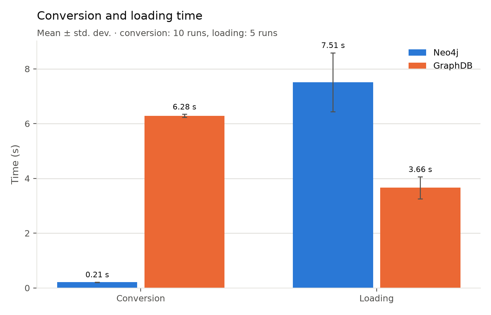
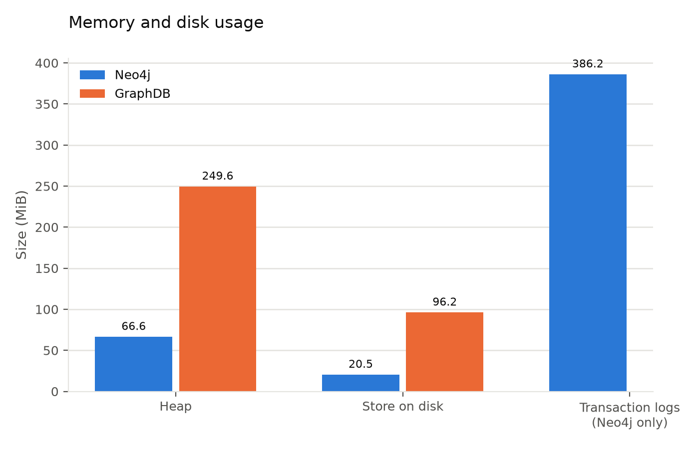
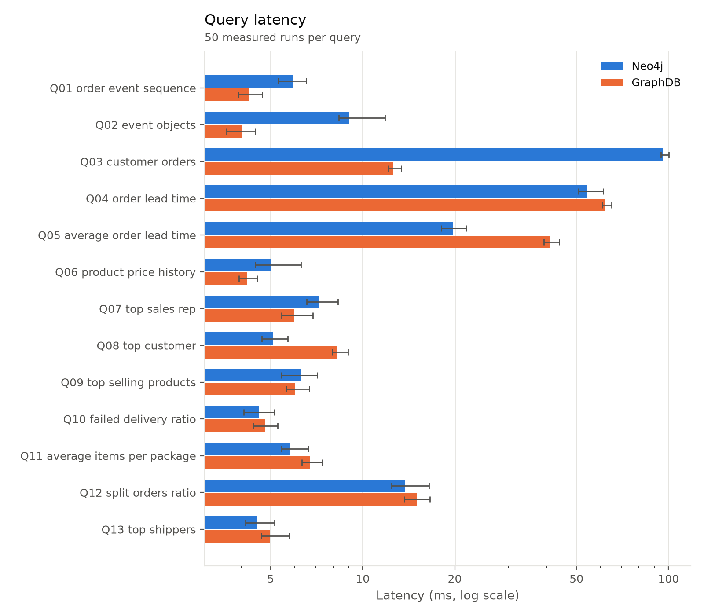

# GraphBench

Comparative study of an RDF triplestore (GraphDB) and a labeled property graph (Neo4j) for modeling and querying an OCEL 2.0 event log, with a focus on expressiveness and performance.

## Table of Contents

1. [Getting Started](#getting-started)
2. [Project Structure](#project-structure)
3. [Background: OCEL 2.0](#background-ocel-20)
4. [Dataset](#dataset)
5. [Analysis](#analysis)
6. [Knowledge Graph Model](#knowledge-graph-model)
   1. [Neo4j](#neo4j)
   2. [GraphDB](#graphdb)
7. [Benchmarking](#benchmarking)

---

# Getting Started

## Technologies

| Technology | Use |
| --- | --- |
| [Python 3.14](https://www.python.org/) + [uv](https://docs.astral.sh/uv/) | conversion, loading, benchmark |
| [rdflib](https://rdflib.readthedocs.io/) | builds and serializes the RDF graph |
| [GraphDB 10.8](https://graphdb.ontotext.com/documentation/10.8/) | RDF triplestore, queried with [SPARQLWrapper](https://sparqlwrapper.readthedocs.io/) and loaded with [requests](https://requests.readthedocs.io/) |
| [Neo4j 2026.10](https://neo4j.com/docs/) | LPG database, via the [Neo4j Python driver](https://neo4j.com/docs/python-manual/current/) |
| [Docker Compose](https://docs.docker.com/compose/) | runs both databases |
| [matplotlib](https://matplotlib.org/) | benchmark plots |

## Prerequisites

- [Docker](https://docs.docker.com/get-docker/) with Docker Compose
- [uv](https://docs.astral.sh/uv/getting-started/installation/) (installs Python 3.14 if missing)

## Setup

```bash
uv sync                      # create .venv and install the dependencies
source .venv/bin/activate    # optional: without it, prefix commands with `uv run`
docker compose up -d         # start GraphDB and Neo4j
```

| Interface         | URL                     | Access                                         |
| ----------------- | ----------------------- | ---------------------------------------------- |
| GraphDB Workbench | <http://localhost:7200> | repository `OrderManagement` (created on first load) |
| Neo4j Browser     | <http://localhost:7474> | user `neo4j`, password `neo4j-pwd`, database `order-management` |

## Running

Modules must be run with `-m` from the repository root.

| Task                     | Command                                                  |
| ------------------------ | -------------------------------------------------------- |
| Convert to RDF           | `python -m graphbench.converters.ocel_to_rdf`            |
| Convert to LPG           | `python -m graphbench.converters.neo4j.converter`        |
| Load into GraphDB        | `python -m graphbench.backends.rdf_backend.importer`     |
| Load into Neo4j          | `python -m graphbench.backends.neo4j_backend.importer`   |
| Full benchmark           | `python -m graphbench.main`                              |
| Plots of a run           | `python -m graphbench.benchmark.plots [run_dir]`         |
| Graph metrics            | `python -m graphbench.analysis.sna`                      |
| Reselect query IDs       | `python -m graphbench.analysis.parameters`               |

> [!IMPORTANT]
> Loading needs the converted files and empties the database first; SNA needs both databases loaded. The full benchmark runs every step, conversion included.

# Project Structure

| Path                        | Content                                                     |
| --------------------------- | ----------------------------------------------------------- |
| `data/`                     | OCEL 2.0 Order Management log (JSON)                        |
| `docs/schemas/`             | LPG and RDF schemas                                         |
| `docs/img/`                 | diagrams                                                    |
| `config/rdf/`               | GraphDB repository configuration                            |
| `queries/`                  | Cypher and SPARQL queries, `parameters.json` (query IDs)    |
| `src/graphbench/`           | Python package                                              |
| ├── `settings.py`           | all settings (paths, connections, run counts)               |
| ├── `datareader/`           | reads the OCEL log into a shared model                      |
| ├── `converters/`           | OCEL → RDF, OCEL → LPG                                      |
| ├── `backends/`             | connection, loading and querying for each database          |
| ├── `benchmark/`            | timings, storage, latency, plots                            |
| ├── `analysis/`             | graph metrics, query ID selection                           |
| └── `main.py`               | runs the full benchmark                                     |
| `output/`                   | converted files (`rdf/`, `neo4j/`) and results (`benchmark/`) |

---

# Background: OCEL 2.0

**OCEL** stands for **Object-Centric Event Log**. Unlike traditional event logs, which associate each event with a single case, an object-centric log allows an event to be linked to many objects of different types, and an object to participate in many events.


_Source: [OCEL 2.0 Specification](https://www.ocel-standard.org/specification/overview)_

Key elements of the metamodel:

| Element | Description                                                                                                                                  |
| ------- | -------------------------------------------------------------------------------------------------------------------------------------------- |
| Event   | Has exactly one type (activity) and one timestamp. Its attributes are **static**: their values are fixed when the event occurs.              |
| Object  | Has exactly one type. Its attributes are **dynamic**: each value is linked to the timestamp at which it was set, so it can change over time. |
| E2O     | Event-to-Object relationship (many-to-many), optionally labeled with a **qualifier**.                                                        |
| O2O     | Object-to-Object relationship (many-to-many), optionally labeled with a **qualifier**. In the metamodel it has **no timestamp**.             |

The metamodel is organized on two levels: the **type level** (event types, object types and their declared attributes) and the **instance level** (events, objects and attribute values).

# Dataset

This project uses the **Order Management** event log from the [OCEL 2.0 event-log collection](https://www.ocel-standard.org/event-logs/simulations/order-management/).

The dataset describes the management of customer orders within a company: registration and payment of incoming orders, and packing and shipping of the ordered items. The company employs staff in the sales, warehousing and shipment departments.

| Property     |  Value |
| ------------ | -----: |
| Event Types  |     11 |
| Object Types |      6 |
| Events       | 21,008 |
| Objects      | 10,840 |

## Physical Schema (SQLite)

The dataset is distributed as an SQLite database following the OCEL 2.0 relational schema.


| Table                      | Content                                                  | Metamodel element                                                |
| -------------------------- | -------------------------------------------------------- | ---------------------------------------------------------------- |
| `event`                    | `ocel_id`, `ocel_type`                                   | Event, _has type_                                                |
| `event_map_type`           | `ocel_type`, `ocel_type_map`                             | Event type → name of its per-type table                          |
| `event_<Type>` (11 tables) | `ocel_id`, `ocel_time`                                   | _has timestamp_ (+ event attribute values, none in this dataset) |
| `object`                   | `ocel_id`, `ocel_type`                                   | Object, _has type_                                               |
| `object_map_type`          | `ocel_type`, `ocel_type_map`                             | Object type → name of its per-type table                         |
| `object_<Type>` (6 tables) | `ocel_id`, `ocel_time`, `ocel_changed_field`, attributes | Object attribute values with their timestamp                     |
| `event_object`             | `ocel_event_id`, `ocel_object_id`, `ocel_qualifier`      | E2O (_has objects_ + qualifier)                                  |
| `object_object`            | `ocel_source_id`, `ocel_target_id`, `ocel_qualifier`     | O2O (_related_ + qualifier)                                      |

> Attribute changes are stored as **additional rows** in the `object_<Type>` tables: `ocel_time` is the moment the value was set and `ocel_changed_field` names the attribute that changed. The `object_object` table has no time column, consistent with the metamodel.

# Analysis

## Event Types

Events are grouped by the department that performs them.

| Area      | Event Type          |
| --------- | ------------------- |
| Sales     | `place order`       |
| Sales     | `confirm order`     |
| Sales     | `payment reminder`  |
| Sales     | `pay order`         |
| Warehouse | `item out of stock` |
| Warehouse | `reorder item`      |
| Warehouse | `pick item`         |
| Warehouse | `create package`    |
| Shipment  | `send package`      |
| Shipment  | `failed delivery`   |
| Shipment  | `package delivered` |

> In this dataset, events have no attributes other than their `type` and `time`. All the information about an event is carried by its E2O relationships.

## Object Types

| Object Type | Attributes                      |
| ----------- | ------------------------------- |
| `orders`    | `price: float`                  |
| `items`     | `weight: float`, `price: float` |
| `packages`  | `weight: float`                 |
| `customers` | –                               |
| `products`  | `weight: float`, `price: float` |
| `employees` | `role: string`                  |

## Event-to-Object Relationships (E2O)

For each event type, the object types it is linked to and the qualifiers used.

### Explicit in the dataset

| Event Type          | Object Type | Qualifier         |
| ------------------- | ----------- | ----------------- |
| `confirm order`     | `customers` | `customer`        |
| `confirm order`     | `employees` | `sales person`    |
| `confirm order`     | `items`     | `item`            |
| `confirm order`     | `orders`    | `order`           |
| `confirm order`     | `products`  | `product`         |
| `create package`    | `employees` | `packer`          |
| `create package`    | `items`     | `item`            |
| `create package`    | `packages`  | `creates`         |
| `create package`    | `products`  | `product`         |
| `failed delivery`   | `employees` | `shipper`         |
| `failed delivery`   | `items`     | `item`            |
| `failed delivery`   | `packages`  | `shipped package` |
| `failed delivery`   | `products`  | `product`         |
| `item out of stock` | `employees` | `employee`        |
| `item out of stock` | `items`     | `item`            |
| `item out of stock` | `products`  | `product`         |
| `package delivered` | `employees` | `shipper`         |
| `package delivered` | `items`     | `item`            |
| `package delivered` | `packages`  | `shipped package` |
| `package delivered` | `products`  | `product`         |
| `pay order`         | `items`     | `item`            |
| `pay order`         | `orders`    | `order`           |
| `pay order`         | `products`  | `product`         |
| `payment reminder`  | `items`     | `item`            |
| `payment reminder`  | `orders`    | `order`           |
| `payment reminder`  | `products`  | `product`         |
| `pick item`         | `employees` | `employee`        |
| `pick item`         | `items`     | `item`            |
| `pick item`         | `products`  | `product`         |
| `place order`       | `customers` | `customer`        |
| `place order`       | `items`     | `item`            |
| `place order`       | `orders`    | `order`           |
| `place order`       | `products`  | `product`         |
| `reorder item`      | `employees` | `employee`        |
| `reorder item`      | `items`     | `item`            |
| `reorder item`      | `products`  | `product`         |
| `send package`      | `employees` | `forwarder`       |
| `send package`      | `employees` | `shipper`         |
| `send package`      | `items`     | `item`            |
| `send package`      | `packages`  | `shipped package` |
| `send package`      | `products`  | `product`         |

## Object-to-Object Relationships (O2O)

Relationships are split by **how they are obtained**, because this affects the conceptual model.

### Explicit in the dataset (`object_object` table)

| Source Object | Qualifier           | Target Object |
| ------------- | ------------------- | ------------- |
| `customers`   | `places`            | `orders`      |
| `employees`   | `primarySalesRep`   | `customers`   |
| `employees`   | `secondarySalesRep` | `customers`   |
| `orders`      | `comprises`         | `items`       |
| `items`       | `is a`              | `products`    |
| `packages`    | `contains`          | `items`       |
| `packages`    | `packed by`         | `employees`   |
| `packages`    | `forwarded by`      | `employees`   |
| `packages`    | `shipped by`        | `employees`   |

## Domain Considerations

- **Many-to-many between orders and packages.** A package can contain items of several orders, and an order can be distributed over several packages.
- **Dynamic attributes.** Product prices increase irregularly due to inflation, which reduces customers' order volumes.
- **Single-face-to-customer policy.** Each customer has a primary sales representative; if unavailable, a secondary one takes over; otherwise any other employee.
- **Loading policy.** A warehousing employee should help the shipment employee load a package, but shippers often load alone or with a second shipment employee.
- **Repeated activities.** Deliveries can fail several times before succeeding.

# Knowledge Graph Model

## Neo4j

The LPG model is defined in [`docs/schemas/lpg/schema.cypher`](docs/schemas/lpg/schema.cypher) using [`Cypher`](https://neo4j.com/docs/cypher-manual/current/introduction/).

The model diagram was created with [arrows.app](https://arrows.app).


The LPG model represents customers, employees, orders, products, packages, and events, together with the relationships between them. It captures sales, order contents, event involvement, and employee responsibilities.

The **blue** nodes represent the **objects**. The **orange** nodes are the events.

### Generating the Neo4j dataset

```bash
python -m graphbench.converters.neo4j.converter
```

1. **Read**: the shared `DataReader` loads `data/order-management.json`, as for RDF.
2. **Generate**: uniqueness constraints, then nodes, relationships (E2O, O2O, `HAS_PRICE`) and indexes. Each operation is a parametrized `UNWIND $rows` query with up to 1,000 rows, using `MERGE` (idempotent).
3. **Write**: the same operations in two formats in `output/neo4j/`:
   - `order-management.jsonl`: one query and its rows per line, used for loading (rows are sent as parameters);
   - `order-management.cypher`: standalone script with the rows inlined.

## GraphDB

The RDF model is defined in [`docs/schemas/rdf/schema.ttl`](docs/schemas/rdf/schema.ttl).


Two namespaces are used: `ocel:` for the metamodel concepts (`Event`, `Object`, `AttributeValue`), reusable with any OCEL log, and `om:` for this dataset's types and relationships.

### Generating the RDF dataset

```bash
python -m graphbench.converters.ocel_to_rdf
```

1. **Read**: the shared `DataReader` loads `data/order-management.json` and normalizes it.
2. **Build**: events, objects, attributes and E2O/O2O relationships are mapped to the classes and properties of the ontology.
3. **Validate**: every class and property used must be declared in the ontology; otherwise the conversion stops.
4. **Write**: the graph is saved to `output/rdf/order-management.ttl`.

# Benchmarking

```bash
docker compose down -v && docker compose up -d   # fresh volumes, for accurate disk sizes
python -m graphbench.main
```

Results go to `output/benchmark/<timestamp>/` (CSV files and `plots/`).

## What is measured

| Phase      | Measure                                                                 |
| ---------- | ----------------------------------------------------------------------- |
| Conversion | time to read the OCEL log, and to convert it to RDF and to LPG (file write included) |
| Loading    | time to import the converted file into each database, after emptying it |
| Storage    | live JVM heap after garbage collection, and size on disk                |
| Graph      | node and edge counts, density, degree ([definitions](docs/sna-metrics.md)) |
| Queries    | latency of the 13 queries (same row counts on both databases)           |

- Every timed run is repeated; resets and garbage collection run before each run, untimed.
- Queries: warm-up passes first, then measured passes with a shuffled query order, alternating which database runs first.
- Memory settings are fixed in `docker-compose.yml`: 2 GB heap for both, plus 2 GB page cache for Neo4j.

## Queries

| # | Query | Question | Files |
| --- | --- | --- | --- |
| Q01 \* | Order event sequence | Which are the events involved given a specific order | [cypher](queries/cypher/01_order_event_sequence.cypher) · [sparql](queries/sparql/01_order_event_sequence.rq) |
| Q02 \* | Event objects | Which are the objects involved given a specific event | [cypher](queries/cypher/02_event_objects.cypher) · [sparql](queries/sparql/02_event_objects.rq) |
| Q03 \* | Customer orders | Which are the orders placed given a specific customer | [cypher](queries/cypher/03_customer_orders.cypher) · [sparql](queries/sparql/03_customer_orders.rq) |
| Q04 | Order lead time | How long each order takes, from placement to the delivery of its last package | [cypher](queries/cypher/04_order_lead_time.cypher) · [sparql](queries/sparql/04_order_lead_time.rq) |
| Q05 | Average order lead time | What is the average lead time of the fully delivered orders | [cypher](queries/cypher/05_average_order_lead_time.cypher) · [sparql](queries/sparql/05_average_order_lead_time.rq) |
| Q06 | Product price history | How the price changes over time given a specific product | [cypher](queries/cypher/06_product_price_history.cypher) · [sparql](queries/sparql/06_product_price_history.rq) |
| Q07 | Top sales rep | Which is the sales person who confirmed the most orders | [cypher](queries/cypher/07_top_sales_rep.cypher) · [sparql](queries/sparql/07_top_sales_rep.rq) |
| Q08 | Top customer | Which is the customer who placed the most orders, and how much they spent in total | [cypher](queries/cypher/08_top_customer.cypher) · [sparql](queries/sparql/08_top_customer.rq) |
| Q09 | Top selling products | Which are the 10 products with the most items sold | [cypher](queries/cypher/09_top_selling_products.cypher) · [sparql](queries/sparql/09_top_selling_products.rq) |
| Q10 | Failed delivery ratio | What is the ratio of failed deliveries to the total delivery attempts (failed + successful) | [cypher](queries/cypher/10_failed_delivery_ratio.cypher) · [sparql](queries/sparql/10_failed_delivery_ratio.rq) |
| Q11 | Average items per package | What is the average number of items contained in a package | [cypher](queries/cypher/11_average_items_per_package.cypher) · [sparql](queries/sparql/11_average_items_per_package.rq) |
| Q12 | Split orders ratio | What is the ratio of orders whose items are spread over different packages to the total orders | [cypher](queries/cypher/12_split_orders_ratio.cypher) · [sparql](queries/sparql/12_split_orders_ratio.rq) |
| Q13 | Top shippers | Which are the 3 shippers who delivered the most packages | [cypher](queries/cypher/13_top_shippers.cypher) · [sparql](queries/sparql/13_top_shippers.rq) |

> [!NOTE]
> \* Parametrized: run with 10 IDs each, from the least to the most connected ([`queries/parameters.json`](queries/parameters.json)).

## Settings

All settings are in [`src/graphbench/settings.py`](src/graphbench/settings.py):

| Setting                 | Meaning                              |
| ----------------------- | ------------------------------------ |
| `CONVERSION_RUNS`       | repetitions of each conversion       |
| `LOADING_RUNS`          | repetitions of each load             |
| `QUERY_WARMUP_RUNS`     | warm-up passes over all queries      |
| `QUERY_RUNS`            | measured passes                      |
| `QUERY_SEED`            | seed of the query shuffling          |
| `QUERY_PARAMETER_COUNT` | IDs per parametrized query           |

Connections, credentials and paths are in the same file; values shared with `docker-compose.yml` must be changed in both.

## Results






