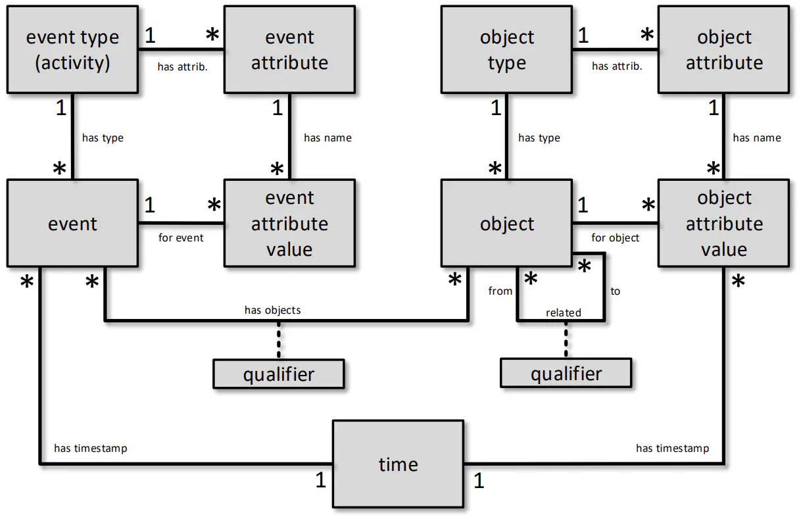
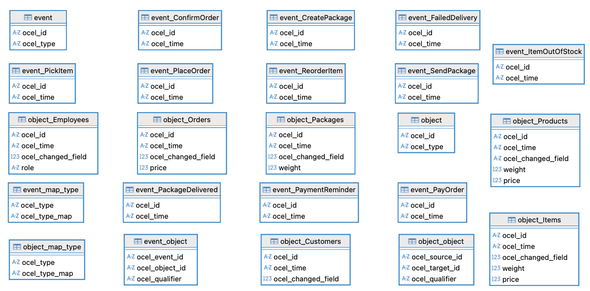
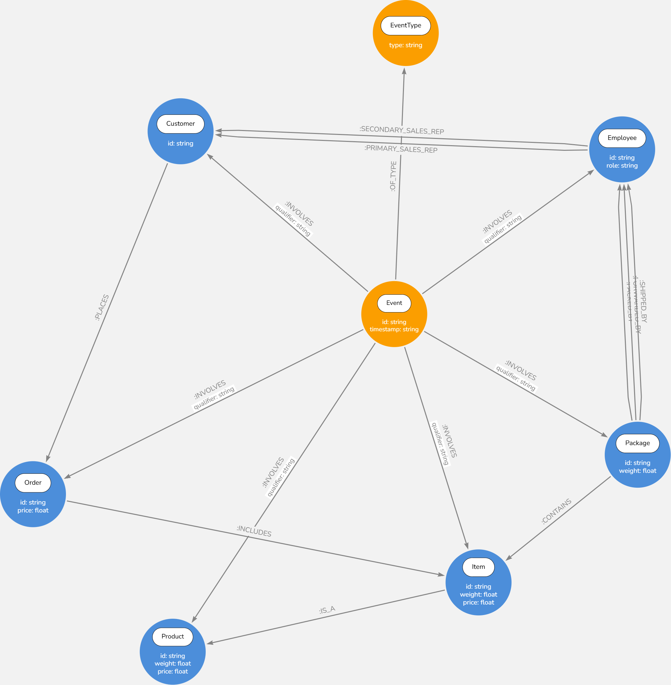
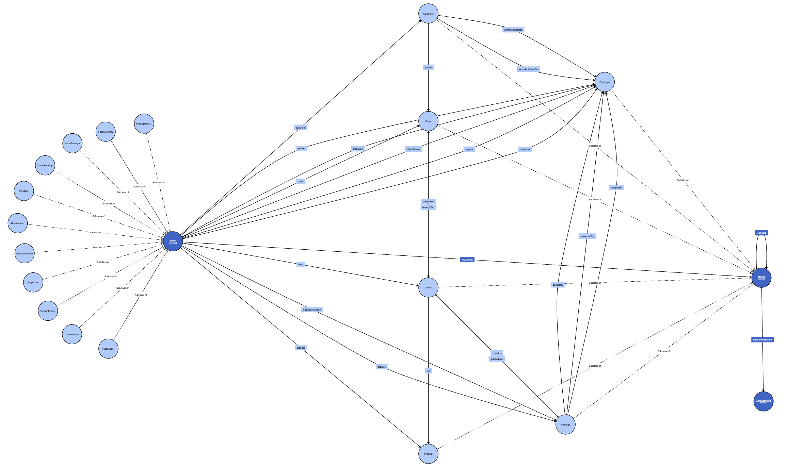

# GraphBench

Comparative study of RDF triplestore and graph approaches for modeling and querying large OCEL datasets, with a focus on expressiveness and performance.

## Table of Contents

1. [Project Structure](#project-structure)
2. [Background: OCEL 2.0](#background-ocel-20)
3. [Dataset](#dataset)
   1. [Physical Schema (SQLite)](#physical-schema-sqlite)
4. [Analysis](#analysis)
   1. [Event Types](#event-types)
   2. [Object Types](#object-types)
   3. [Event-to-Object Relationships (E2O)](#event-to-object-relationships-e2o)
   4. [Object-to-Object Relationships (O2O)](#object-to-object-relationships-o2o)
   5. [Domain Considerations](#domain-considerations)
5. [Knowledge Graph Model](#knowledge-graph-model)
   1. [Neo4j](#neo4j)
   2. [GraphDB](#graphdb)
6. [Benchmarking](#benchmarking)

---

# Project Structure

The repository is organized into the following directories:

| Directory / File     | Description                                                                                               |
| -------------------- | --------------------------------------------------------------------------------------------------------- |
| `data/`              | Input dataset used by the project, including the OCEL 2.0 Order Management event log.                     |
| `docker-compose.yml` | Defines and orchestrates the project's containerized services, including the graph database environments. |
| `docs/`              | Documentation and data-model definitions, including LPG and RDF schemas and their diagrams.               |
| `docs/img/`          | Diagrams and visualizations of the OCEL metamodel, LPG model, RDF model, and SQLite schema.               |
| `docs/lpg-model/`    | Neo4j/LPG schema definitions and import files.                                                            |
| `docs/rdf-model/`    | RDF schema definitions, Turtle files, and GraphDB import/layout files.                                    |
| `output/`            | Generated artifacts produced by the conversion and benchmarking workflows.                                |
| `output/benchmark/`  | Benchmark results and related generated files.                                                            |
| `output/neo4j/`      | Generated Neo4j/Cypher representations of the OCEL dataset.                                               |
| `output/rdf/`        | Generated RDF/Turtle representations of the OCEL dataset.                                                 |
| `queries/`           | Queries used for evaluating and comparing the graph models.                                               |
| `queries/cypher/`    | Cypher queries for the Neo4j/LPG model.                                                                   |
| `queries/sparql/`    | SPARQL queries for the RDF/GraphDB model.                                                                 |
| `src/`               | Python source code for data conversion and benchmarking.                                                  |
| `src/converters/`    | Converters that transform OCEL data into Neo4j/Cypher and RDF/Turtle representations.                     |
| `src/benchmark/`     | Benchmarking utilities and the benchmark runner.                                                          |
| `requirements.txt`   | Python dependencies required by the project.                                                              |

## Graph Database Interfaces

When the project is started using `Docker Compose`, the web interfaces of the graph databases are available at:

- **Neo4j:** `http://localhost:7474`
- **GraphDB:** `http://localhost:7200`

These interfaces can be used to inspect the loaded graph data and execute **Cypher** or **SPARQL** queries, respectively.

---

# Background: OCEL 2.0

**OCEL** stands for **Object-Centric Event Log**. Unlike traditional event logs, which associate each event with a single case, an object-centric log allows an event to be linked to many objects of different types, and an object to participate in many events.



_Source: [OCEL 2.0 Specification](https://www.ocel-standard.org/specification/overview)_

Key elements of the metamodel:

| Element | Description                                                                                                                                  |
| ------- | -------------------------------------------------------------------------------------------------------------------------------------------- |
| Event   | Has exactly one type (activity) and one timestamp. Its attributes are **static**: their values are fixed when the event occurs.              |
| Object  | Has exactly one type. Its attributes are **dynamic**: each value is linked to the timestamp at which it was set, so it can change over time. |
| E2O     | Event-to-Object relationship (many-to-many), optionally labeled with a **qualifier**.                                                        |
| O2O     | Object-to-Object relationship (many-to-many), optionally labeled with a **qualifier**. In the metamodel it has **no timestamp**.             |

The metamodel is organized on two levels: the **type level** (event types, object types and their declared attributes) and the **instance level** (events, objects and attribute values).

# Dataset

This project uses the **Order Management** event log from the [OCEL 2.0 event-log collection](https://www.ocel-standard.org/event-logs/simulations/order-management/).

The dataset describes the management of customer orders within a company: registration and payment of incoming orders, and packing and shipping of the ordered items. The company employs staff in the sales, warehousing and shipment departments.

| Property     |  Value |
| ------------ | -----: |
| Event Types  |     11 |
| Object Types |      6 |
| Events       | 21,008 |
| Objects      | 10,840 |

## Physical Schema (SQLite)

The dataset is distributed as an SQLite database following the OCEL 2.0 relational schema.



| Table                      | Content                                                  | Metamodel element                                                |
| -------------------------- | -------------------------------------------------------- | ---------------------------------------------------------------- |
| `event`                    | `ocel_id`, `ocel_type`                                   | Event, _has type_                                                |
| `event_map_type`           | `ocel_type`, `ocel_type_map`                             | Event type → name of its per-type table                          |
| `event_<Type>` (11 tables) | `ocel_id`, `ocel_time`                                   | _has timestamp_ (+ event attribute values, none in this dataset) |
| `object`                   | `ocel_id`, `ocel_type`                                   | Object, _has type_                                               |
| `object_map_type`          | `ocel_type`, `ocel_type_map`                             | Object type → name of its per-type table                         |
| `object_<Type>` (6 tables) | `ocel_id`, `ocel_time`, `ocel_changed_field`, attributes | Object attribute values with their timestamp                     |
| `event_object`             | `ocel_event_id`, `ocel_object_id`, `ocel_qualifier`      | E2O (_has objects_ + qualifier)                                  |
| `object_object`            | `ocel_source_id`, `ocel_target_id`, `ocel_qualifier`     | O2O (_related_ + qualifier)                                      |

> Attribute changes are stored as **additional rows** in the `object_<Type>` tables: `ocel_time` is the moment the value was set and `ocel_changed_field` names the attribute that changed. The `object_object` table has no time column, consistent with the metamodel.

# Analysis

## Event Types

Events are grouped by the department that performs them.

| Area      | Event Type          |
| --------- | ------------------- |
| Sales     | `place order`       |
| Sales     | `confirm order`     |
| Sales     | `payment reminder`  |
| Sales     | `pay order`         |
| Warehouse | `item out of stock` |
| Warehouse | `reorder item`      |
| Warehouse | `pick item`         |
| Warehouse | `create package`    |
| Shipment  | `send package`      |
| Shipment  | `failed delivery`   |
| Shipment  | `package delivered` |

> In this dataset, events have no attributes other than their `type` and `time`. All the information about an event is carried by its E2O relationships.

## Object Types

| Object Type | Attributes                      |
| ----------- | ------------------------------- |
| `orders`    | `price: float`                  |
| `items`     | `weight: float`, `price: float` |
| `packages`  | `weight: float`                 |
| `customers` | –                               |
| `products`  | `weight: float`, `price: float` |
| `employees` | `role: string`                  |

## Event-to-Object Relationships (E2O)

For each event type, the object types it is linked to and the qualifiers used.

### Explicit in the dataset

| Event Type          | Object Type | Qualifier         |
| ------------------- | ----------- | ----------------- |
| `confirm order`     | `customers` | `customer`        |
| `confirm order`     | `employees` | `sales person`    |
| `confirm order`     | `items`     | `item`            |
| `confirm order`     | `orders`    | `order`           |
| `confirm order`     | `products`  | `product`         |
| `create package`    | `employees` | `packer`          |
| `create package`    | `items`     | `item`            |
| `create package`    | `packages`  | `creates`         |
| `create package`    | `products`  | `product`         |
| `failed delivery`   | `employees` | `shipper`         |
| `failed delivery`   | `items`     | `item`            |
| `failed delivery`   | `packages`  | `shipped package` |
| `failed delivery`   | `products`  | `product`         |
| `item out of stock` | `employees` | `employee`        |
| `item out of stock` | `items`     | `item`            |
| `item out of stock` | `products`  | `product`         |
| `package delivered` | `employees` | `shipper`         |
| `package delivered` | `items`     | `item`            |
| `package delivered` | `packages`  | `shipped package` |
| `package delivered` | `products`  | `product`         |
| `pay order`         | `items`     | `item`            |
| `pay order`         | `orders`    | `order`           |
| `pay order`         | `products`  | `product`         |
| `payment reminder`  | `items`     | `item`            |
| `payment reminder`  | `orders`    | `order`           |
| `payment reminder`  | `products`  | `product`         |
| `pick item`         | `employees` | `employee`        |
| `pick item`         | `items`     | `item`            |
| `pick item`         | `products`  | `product`         |
| `place order`       | `customers` | `customer`        |
| `place order`       | `items`     | `item`            |
| `place order`       | `orders`    | `order`           |
| `place order`       | `products`  | `product`         |
| `reorder item`      | `employees` | `employee`        |
| `reorder item`      | `items`     | `item`            |
| `reorder item`      | `products`  | `product`         |
| `send package`      | `employees` | `forwarder`       |
| `send package`      | `employees` | `shipper`         |
| `send package`      | `items`     | `item`            |
| `send package`      | `packages`  | `shipped package` |
| `send package`      | `products`  | `product`         |

## Object-to-Object Relationships (O2O)

Relationships are split by **how they are obtained**, because this affects the conceptual model.

### Explicit in the dataset (`object_object` table)

| Source Object | Qualifier           | Target Object |
| ------------- | ------------------- | ------------- |
| `customers`   | `places`            | `orders`      |
| `employees`   | `primarySalesRep`   | `customers`   |
| `employees`   | `secondarySalesRep` | `customers`   |
| `orders`      | `comprises`         | `items`       |
| `items`       | `is a`              | `products`    |
| `packages`    | `contains`          | `items`       |
| `packages`    | `packed by`         | `employees`   |
| `packages`    | `forwarded by`      | `employees`   |
| `packages`    | `shipped by`        | `employees`   |

## Domain Considerations

- **Many-to-many between orders and packages.** A package can contain items of several orders, and an order can be distributed over several packages.
- **Dynamic attributes.** Product prices increase irregularly due to inflation, which reduces customers' order volumes.
- **Single-face-to-customer policy.** Each customer has a primary sales representative; if unavailable, a secondary one takes over; otherwise any other employee.
- **Loading policy.** A warehousing employee should help the shipment employee load a package, but shippers often load alone or with a second shipment employee.
- **Repeated activities.** Deliveries can fail several times before succeeding.

# Knowledge Graph Model

## Neo4j

The LPG model is defined in [`docs/lpg-model/LPG_schema.cypher`](docs/lpg-model/LPG_schema.cypher) using [`Cypher`](https://neo4j.com/docs/cypher-manual/current/introduction/).

The model diagram was created with [arrows.app](https://arrows.app).



The LPG model represents customers, employees, orders, products, packages, and events, together with the relationships between them. It captures sales, order contents, event involvement, and employee responsibilities.

The **blue** nodes represent the **objects**. The **orange** nodes are the events.

## GraphDB

The RDF model is defined in [`docs/rdf-model/RDF_schema.ttl`](docs/rdf-model/RDF_schema.ttl).



Two namespaces are used: `ocel:` for the metamodel concepts (`Event`, `Object`, `AttributeValue`), reusable with any OCEL log, and `om:` for this dataset's types and relationships.

### Generating the RDF dataset

```bash
uv run python -m graphbench.converters.ocel_to_rdf
```

The conversion from OCEL 2.0 to RDF runs in four steps:

1. **Read**: the shared `DataReader` loads `data/order-management.json` and normalizes it. The same reader is used by the Neo4j converter, so both graphs start from identical data.
2. **Build**: events, objects, attributes and E2O/O2O relationships are mapped to the classes and properties of the ontology through the mapping tables at the top of the converter.
3. **Validate**: every class and property used in the data must be declared in the ontology; otherwise the conversion stops.
4. **Write**: the graph is saved to `output/rdf/order-management.ttl`.

# Benchmarking

TBD (WP7, WP8, WP11)
